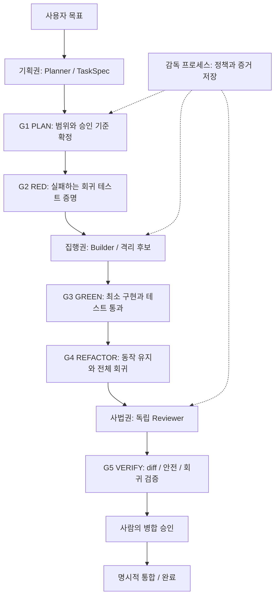

# 01. 아키텍처: 역할 분리와 TDD 5단계

상태: 설계/계약 v1.0. 이 디렉토리는 기존 v3 실행 코드와 독립적이며 연결되지 않는다.
Python 3.11+ 단일 로컬 감독 프로세스가 시작점이다. 분산 실행은 이후 확장 사항이다.

기획자는 목표·허용 경로·수용 기준을 정하고 구현 파일을 쓰지 않는다. 구현자는 테스트와
제품 코드를 제안한다. 검토자는 후보를 읽고 검증하며 직접 고치지 않는다. 감독 프로세스가
프로세스 실행·패치 적용·정책·상태를 소유한다. AI가 출력한 `pass`만으로 게이트를 통과시키지 않는다.
기본 역할은 Codex 기획 / Claude 구현 / Gemini 검토이나 교체 가능하다.
동일 작업의 Builder와 Reviewer 공급자는 반드시 달라야 한다. 동일 공급자의 다른 세션도
독립 검토로 인정하지 않는다. 역할 분리는 모델 편향을 완전히 제거하지 않는다.

| 게이트 | 담당 | 필수 통과 증거 |
|---|---|---|
| PLAN | Planner + 감독 | 유효 TaskSpec, clean base, 명시적 테스트 argv, 정책 교집합 |
| RED | Builder + 감독 | 기준 커밋은 기존 회귀 통과, 새 테스트는 지정된 assertion으로 실패 |
| GREEN | Builder + 감독 | 고정된 새 테스트 및 기존 회귀 전체 통과 |
| REFACTOR | Builder + 감독 | 리팩터 또는 사유 있는 no-op, 고정 테스트·회귀 재통과 |
| VERIFY | Reviewer + 감독 | 독립 검토, 최종 후보 해시, 전체 테스트·스코프 가드 통과 |

RED의 syntax/import 오류, 실행 불가, 타임아웃은 예상 실패가 아니다. RED 증거에는 실패한
테스트 ID, assertion, 기준 테스트 해시를 고정한다. 이후 삭제·skip·완화하면 PLAN부터 새 승인이 필요하다.
문서만 바꾸는 작업도 임의로 RED를 생략하지 않는다. 검증 가능한 계약 테스트를 정의하거나 blocked 처리한다.

모듈 경계: adapters는 공급자 입출력 변환, core는 버전 계약, pipeline은 상태 정책,
safety는 범위 판정이다. 향후 supervisor/worktrees/evidence 모듈을 추가한다.
증거 저장소는 작업 worktree 밖에 두고, SHA-256으로 증거를 참조한다. 이는 변조 검출용이며
서명/접근 통제 없이 신뢰를 보장하지 않는다. 단일 writer와 OS lock, SQLite 트랜잭션으로
상태·이벤트를 저장하고 재시작 시 실제 프로세스/HEAD와 대조한다.

한 번의 명령 실행을 exactly-once로 가정하지 않는다. 요청 UUID와 attempt로 중복을 탐지하고,
상태 전이는 version compare-and-swap으로 한 번만 반영한다. 여러 감독 노드를 지원할 때에는
lease와 fencing token을 별도로 구현해야 한다. 초기 버전은 동시 감독 실행을 거부한다.
